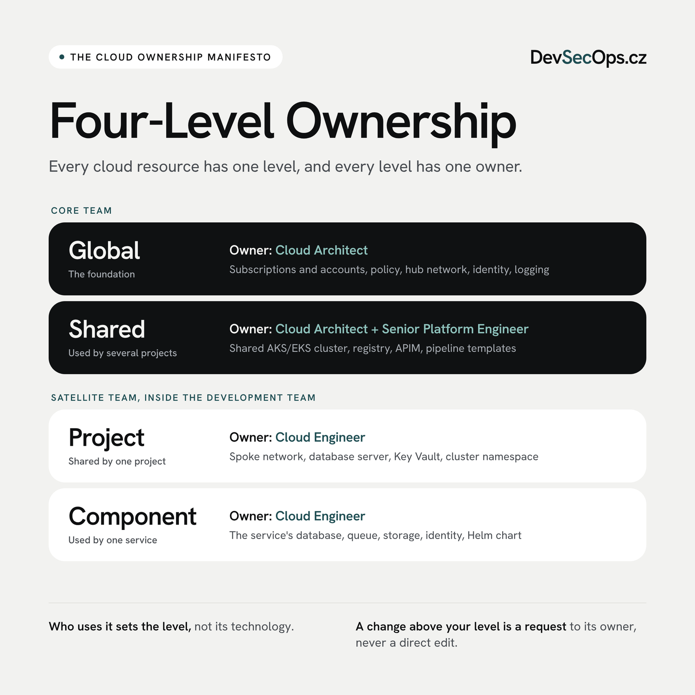

# The Cloud Ownership Manifesto

> **Draft for public review until 18 December 2026.** Open an issue with your critique: what is wrong, what is missing, where it would not work in your team. Agree with it? Sign it in [SIGNATORIES.md](SIGNATORIES.md).

v1.0 · CC BY 4.0 · Written by [DevSecOps.cz](https://devsecops.cz)

This manifesto is for everyone who builds and runs cloud infrastructure: platform and DevOps engineers, developers, architects and the people who lead them. It was written by DevSecOps.cz, a managed DevOps team, from how we run our clients' clouds.

## We value

- **Clear ownership levels** over everyone touching everything
- **Code and pipelines** over consoles and clicks
- **Secure by default** over secure on request
- **Self-service and automation** over tickets and handovers
- **Enabling your teams** over replacing them
- **Cost as a design input** over cost as a monthly surprise
- **Written runbooks** over knowledge in people's heads
- **AI that proposes, humans who decide** over unreviewed automation
- **Measured outcomes** over effort and activity

The items on the right still matter. When they conflict, we choose the left.

## Non-negotiables

1. **If it is not declared, it does not exist.**
2. **Every infrastructure change goes through the pipeline.**
3. **Security checks are a must.** A failed check stops the change.
4. **A human approves every change made by AI.**
5. **Environments that are not separated are one environment.** If dev can reach prod, dev is prod.

## Principles

Each value has one principle that says what it means in daily work: [PRINCIPLES.md](PRINCIPLES.md).

## Sign it

Agree with it? Add your name to [SIGNATORIES.md](SIGNATORIES.md) in a pull request. See [CONTRIBUTING.md](CONTRIBUTING.md).

## How this manifesto changes

The manifesto is stable; the principles are living.

- The manifesto changes at most once a year, after a public review.
- Principles change through pull requests to this repo, reviewed by DevSecOps.cz as maintainers.
- Anyone can propose a change, including engineers on client teams.

Every change is recorded in [CHANGELOG.md](CHANGELOG.md).

## Licence

This work is licensed under [Creative Commons Attribution 4.0 International](https://creativecommons.org/licenses/by/4.0/). You may copy and adapt it for any purpose if you credit DevSecOps.cz. See [LICENSE](LICENSE).
